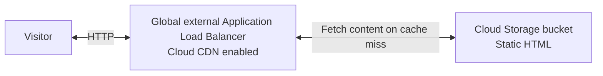
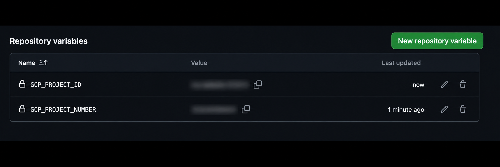

# my-website on GCP

A website hosted in Cloud Storage, served through a global external Application Load Balancer with Cloud CDN.



- Terraform manages the cloud resources.
- GitHub Actions deploys using Workload Identity Federation.
   - No service-account keys are needed.

## Environments

| Branch | Environment | Website deployment | IaC |
| --- | --- | --- | --- |
| `develop` | `dev` | Automatically on website changes merged/pushed to `develop`, or manually | Manual `plan` or `apply` from `develop` only |
| `main` | `production` | Automatically on website changes merged/pushed to `main`, or manually | Manual `plan` or `apply` from `main` only |

Default region: `us-east1`.

## Repo Structure

```text
my-website/
├── .github/
│   └── workflows/
│       ├── iac.yml                  # Manual plan and apply
│       └── website.yml              # HTML deployment and CDN invalidation
├── docs/
│   └── images/                      # README images
├── iac/
│   ├── .terraform.lock.hcl          # Provider versions and checksums (auto-gen)
│   ├── state.tf                     # Remote state and protected state bucket
│   ├── providers.tf                 # Google and Google Beta providers
│   ├── versions.tf                  # Terraform and provider requirements
│   ├── locals.tf                    # Branches and state-bucket names
│   ├── iam.tf                       # Federation, service accounts, and permissions
│   ├── main.tf                      # Website module configuration (main starting point)
│   ├── variables.tf                 # Project, region, and environment settings
│   ├── outputs.tf                   # Project, authentication, and hosting values
│   ├── environments/
│   │   ├── dev/
│   │   │   ├── state.hcl            # State bucket: my-website-iac-state-dev
│   │   │   └── terraform.tfvars     # Dev environment settings
│   │   └── production/
│   │       ├── state.hcl            # State bucket: my-website-iac-state-production
│   │       └── terraform.tfvars     # Production environment settings
│   └── modules/
│       └── static-website/
│           ├── storage.tf           # Website bucket and public access
│           ├── load-balancer.tf     # Reserved IP, routing, and CDN
│           ├── variables.tf         # Module inputs
│           ├── outputs.tf           # Module outputs
│           └── versions.tf          # Required providers
├── scripts/
│   ├── terraform-init               # Prepare state and GitHub authentication
│   └── deploy-website.sh            # Upload, invalidate cache, and verify release
├── website/
│   ├── index.html
│   └── 404.html
├── .gitignore
└── README.md
```

## Setup

Make these files available on `main` and `develop` before starting. GitHub requires manual workflows to exist on the default branch (`main`).

### GCP

In Cloud Shell, run once with an administrative Google account and billing enabled for the project. The script enables APIs, prepares both private state buckets, and configures GitHub federation and IaC service accounts.

```bash
# For a fork or another repository, use its clone URL and pass its name and numeric IDs below.
git clone https://github.com/gtaufic/my-website.git
cd my-website

# Find your project ID and number
# PROJECT_ID: my-website-xyz123
# NAME: my-website
# PROJECT_NUMBER: 1234567
# ENVIRONMENT:
gcloud projects list

# Find repo id and owner id
# {
#   "repository_id": 1424364185,
#   "owner_id": 67336406
# }
curl -fsSL https://api.github.com/repos/gtaufic/my-website \
  | jq '{repository_id: .id, owner_id: .owner.id}'

# ./scripts/terraform-init "<gcp project id>" "<github owner/repo>" "<repository id>" "<owner id>"
./scripts/terraform-init my-website-xyz123 gtaufic/my-website 1424364185 67336406
```

### GitHub Actions

Allow up to five minutes after bootstrap for Google IAM changes to propagate.

GitHub creates `dev` when you first run **iac** on `develop`, and `production` when you run it on `main`.

Repository details are detected automatically. Add the two variables printed by the bootstrap script as repository-level Actions variables, shared by both environments:

**Settings → Secrets and variables → Actions → Variables → New repository variable**

- `GCP_PROJECT_ID`: GCP project ID.
- `GCP_PROJECT_NUMBER`: Numeric project number.



1. Manually run **iac** with operation **apply** on `develop` to set up dev.
2. Repeat on `main` to set up production.
3. Run **website** on each branch to publish the HTML.

The first apply imports the bootstrap resources and creates the hosting stack. Future website changes deploy automatically as described above.

## Next steps

1. Support custom domains with DNS configuration and managed HTTPS certificates.
2. Deploy versioned web assets to support caching and rollbacks.
