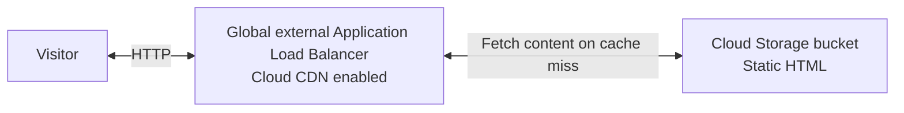
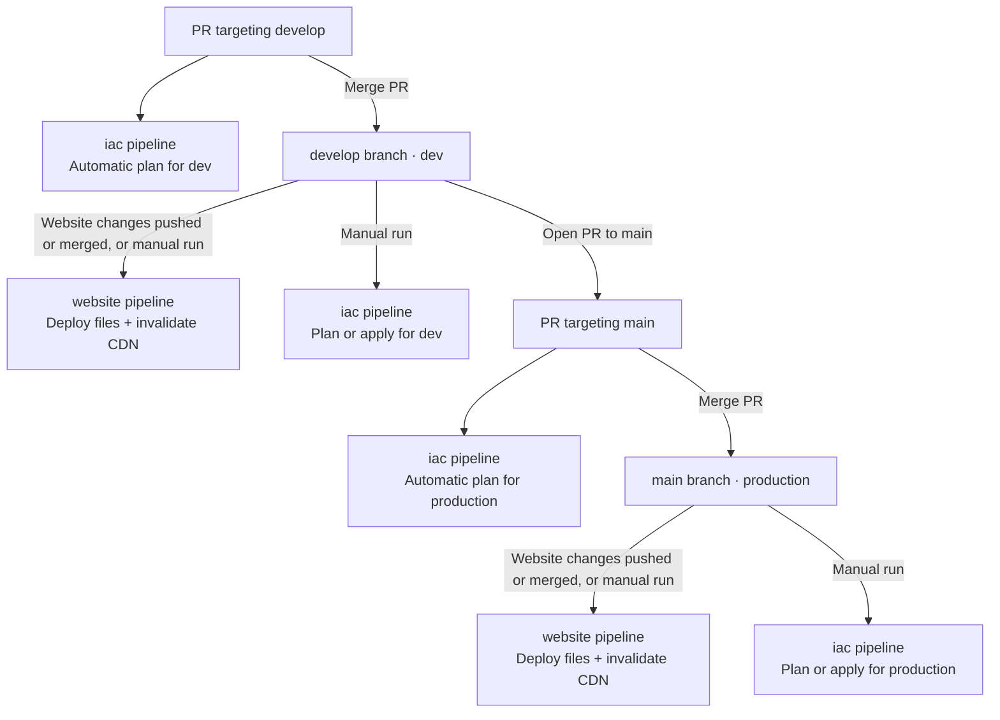
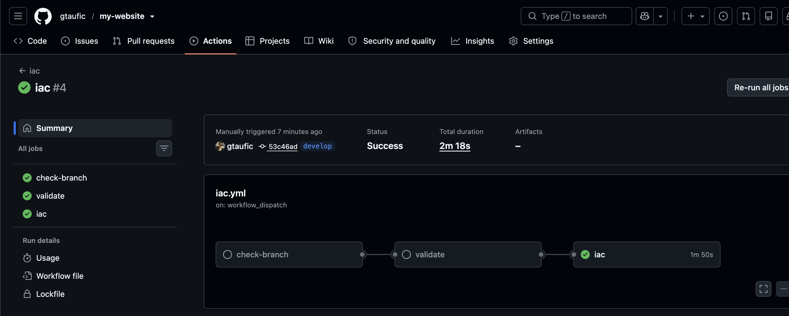
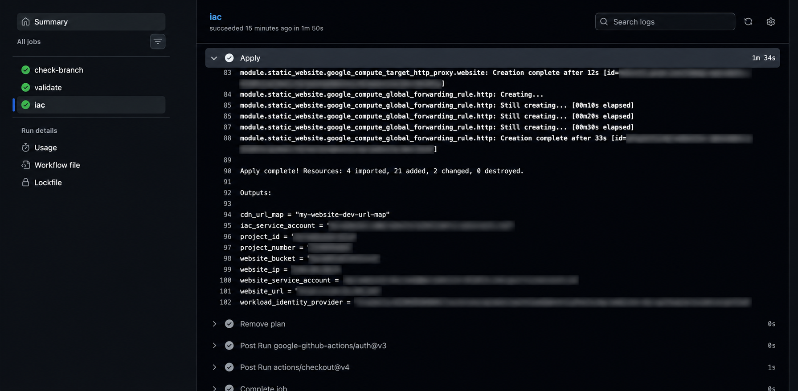
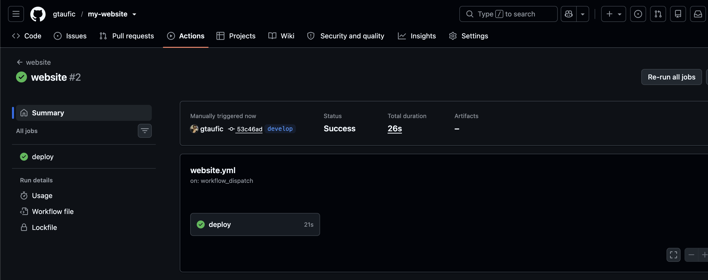
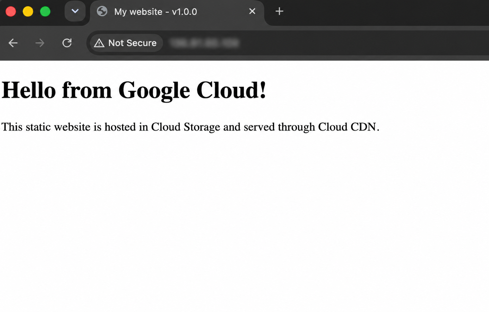

# my-website on GCP

A website hosted in Cloud Storage, served through a global external Application Load Balancer with Cloud CDN.



- Terraform manages the cloud resources.
- GitHub Actions deploys using Workload Identity Federation.
   - No service-account keys are needed.

## Environments



Default region: `us-east1`.

PR plans use a read-only service account and appear in the workflow logs. Fork PRs run validation only. Applies remain manual.

## Repo Structure

```text
my-website/
├── .github/
│   └── workflows/
│       ├── iac.yml                  # PR plans; manual plan and apply
│       └── website.yml              # Website deployment and CDN invalidation
├── docs/
│   └── images/                      # README images
├── iac/
│   ├── .terraform.lock.hcl          # Provider versions and checksums (auto-gen)
│   ├── state.tf                     # Remote state and protected state bucket
│   ├── providers.tf                 # Google and Google Beta providers
│   ├── versions.tf                  # Terraform and provider requirements
│   ├── locals.tf                    # Branches and state-bucket names
│   ├── iam.tf                       # Federation, service accounts, and permissions
│   ├── main.tf                      # Website module configuration (main starting point)
│   ├── variables.tf                 # Project, region, and environment settings
│   ├── outputs.tf                   # Project, authentication, and hosting values
│   ├── environments/
│   │   ├── dev/
│   │   │   ├── state.hcl            # State bucket: my-website-iac-state-dev
│   │   │   └── terraform.tfvars     # Dev environment settings
│   │   └── production/
│   │       ├── state.hcl            # State bucket: my-website-iac-state-production
│   │       └── terraform.tfvars     # Production environment settings
│   └── modules/
│       └── static-website/
│           ├── storage.tf           # Website bucket and public access
│           ├── load-balancer.tf     # Reserved IP, routing, and CDN
│           ├── variables.tf         # Module inputs
│           ├── outputs.tf           # Module outputs
│           └── versions.tf          # Required providers
├── scripts/
│   ├── terraform-init               # Prepare state and GitHub authentication
│   └── deploy-website.sh            # Upload, invalidate cache, and verify release
├── website/
│   ├── assets/
│   ├── index.html
│   └── 404.html
├── .gitignore
└── README.md
```

## Setup

### GCP

In Cloud Shell, run once with an administrative Google account and billing enabled for the project. The script enables APIs, prepares private state buckets for dev and production, and configures GitHub federation and IaC service accounts.

```bash
# For a fork or another repository, use its clone URL and pass its name and numeric IDs below.
git clone https://github.com/gtaufic/my-website.git
cd my-website

# Find your project ID and number
# PROJECT_ID: my-website-xyz123
# NAME: my-website
# PROJECT_NUMBER: 1234567
# ENVIRONMENT:
gcloud projects list

# Find repo id and owner id
# {
#   "repository_id": 1424364185,
#   "owner_id": 67336406
# }
curl -fsSL https://api.github.com/repos/gtaufic/my-website \
  | jq '{repository_id: .id, owner_id: .owner.id}'

# ./scripts/terraform-init "<gcp project id>" "<github owner/repo>" "<repository id>" "<owner id>"
./scripts/terraform-init my-website-xyz123 gtaufic/my-website 1424364185 67336406
```

### GitHub Actions

Add these repository-level Actions secrets, shared by both environments:

**Settings → Secrets and variables → Actions → Secrets → New repository secret**

- `GCP_PROJECT_ID`: GCP project ID.
- `GCP_PROJECT_NUMBER`: Numeric project number.

## First run

After bootstrap, allow up to five minutes for IAM permissions to propagate.

1. Open **Actions → iac → Run workflow**, select `develop` and operation `apply`, and wait for success.
2. Run **website** on `develop` to publish the HTML.
3. Once these files are on `main`, repeat **iac → apply**, then **website**, on `main` for production.









The first apply imports the bootstrap resources and creates the hosting stack and deployment accounts, including the read-only PR plan account. Later website changes deploy automatically.

For an existing setup, run one manual **iac → apply** with these changes on each environment's branch before using automatic PR plans. This creates the plan account and updates federation.

## Next implementation steps

1. Support custom domains with DNS configuration and managed HTTPS certificates.
2. Deploy versioned web assets to support caching and rollbacks.
