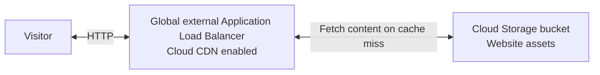
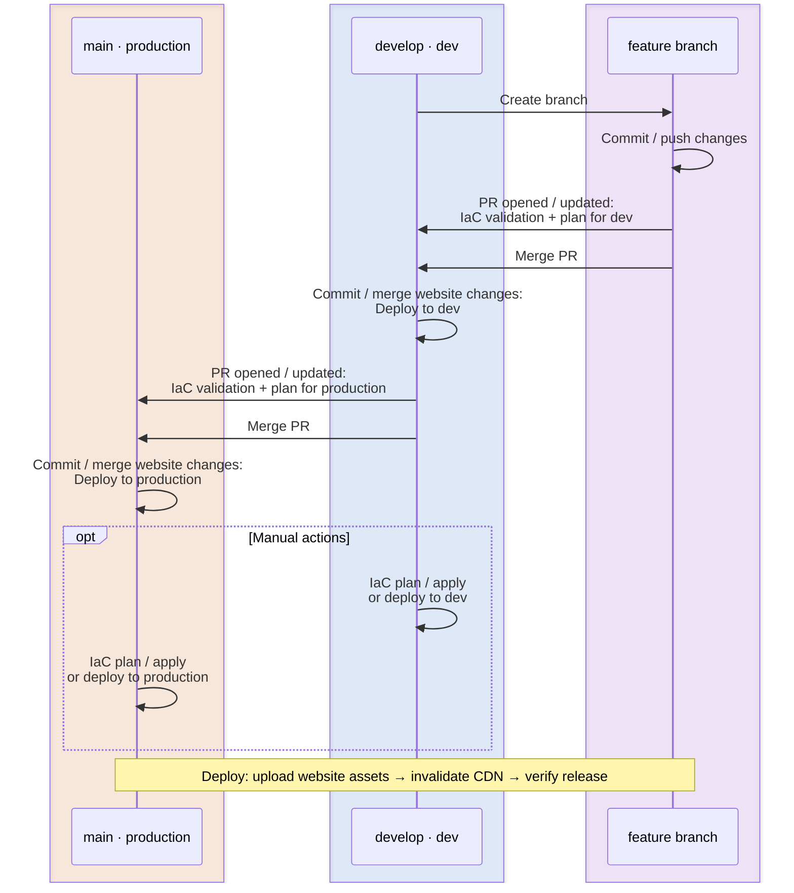
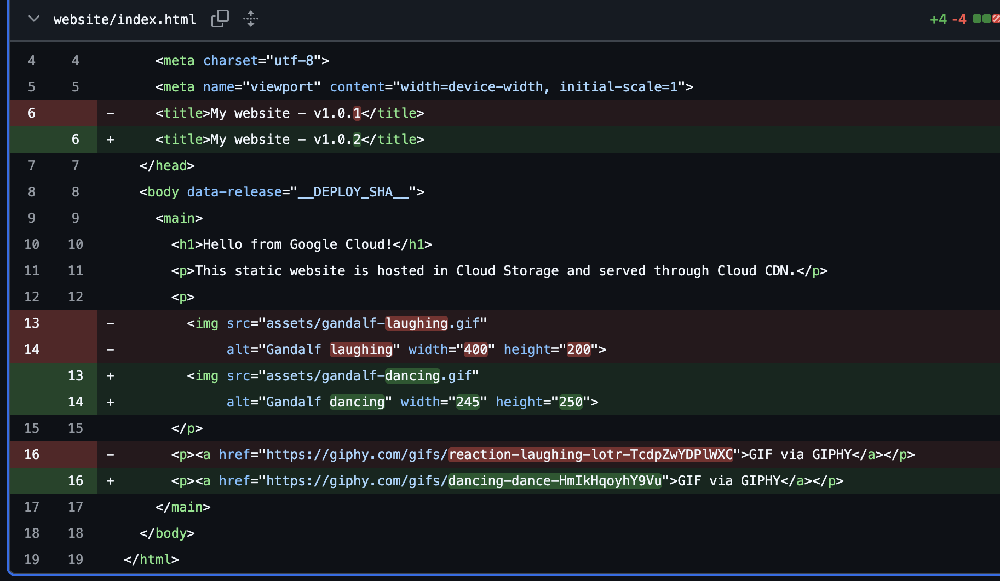
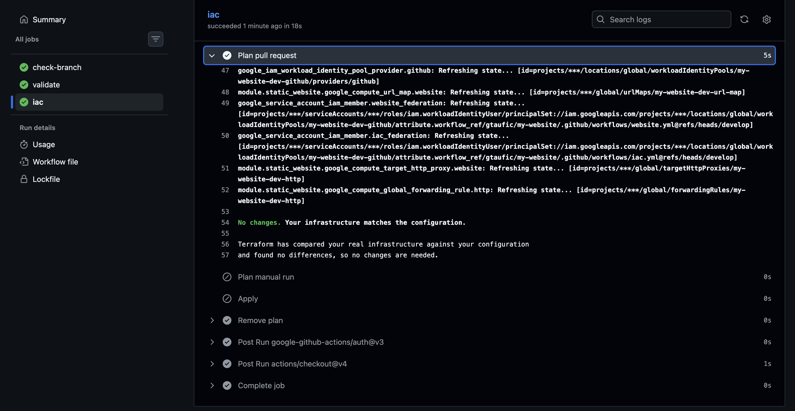
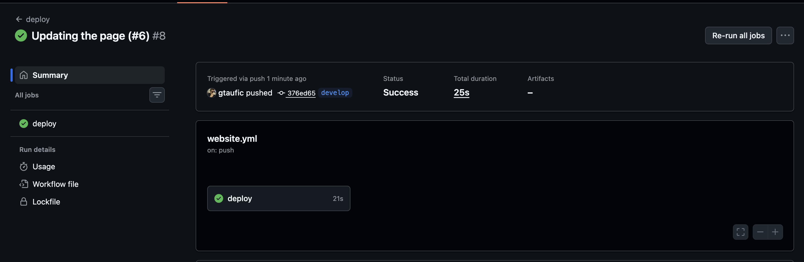
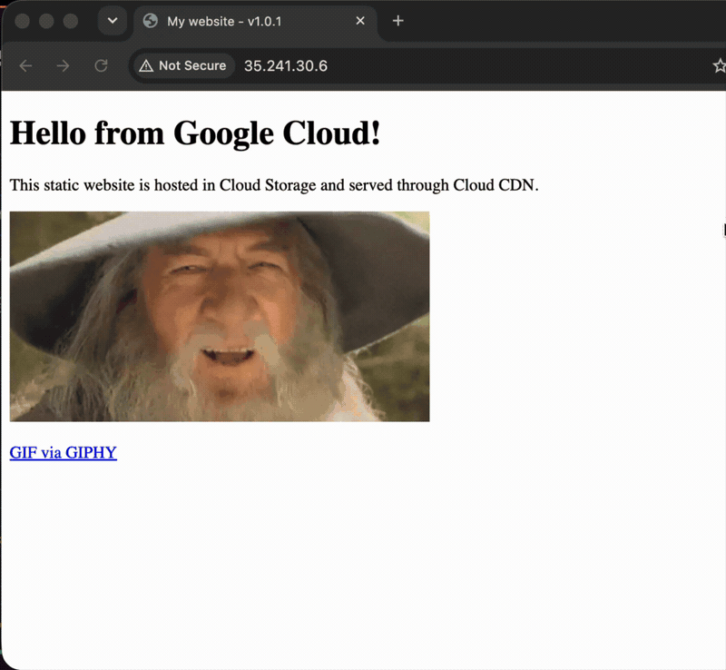

# my-website on GCP

A website hosted in Cloud Storage, served through a global external Application Load Balancer with Cloud CDN.

This project explores a simple way to serve static application assets, such as those produced by a React build. The goal is reliable delivery with low latency worldwide and easy releases whenever the assets change. The initial solution was built in a few hours.

Last published dev endpoint: [http://136.68.16.48/](http://136.68.16.48/). This temporary testing environment may be shut down soon.



- [Cloud Storage](iac/modules/static-website/storage.tf) holds the website assets, and [Cloud CDN](iac/modules/static-website/load-balancer.tf#L6-L20) caches responses to reduce repeated origin requests.
- A [reserved global IP](iac/modules/static-website/load-balancer.tf#L1-L4) keeps the website endpoint stable across deployments.
- Terraform manages storage, the load balancer, CDN, and IAM through a [reusable hosting module](iac/modules/static-website/) and [configurable inputs](iac/variables.tf).
- [Dev](iac/environments/dev/) and [production](iac/environments/production/) use the same code in separate GCP projects, with separate configuration, state buckets, and service accounts.
- [Terraform state](iac/state.tf) is stored in private, versioned Cloud Storage buckets with state locking and protection against accidental deletion.
- [GitHub Actions](.github/workflows/iac.yml) authenticates through [Workload Identity Federation](iac/iam.tf#L23-L51) using short-lived credentials. No service-account keys are needed.
- Separate [service accounts](iac/iam.tf#L53-L70) handle read-only PR plans, IaC changes, and website deployment. Website uploads are [scoped to the website bucket](iac/iam.tf#L136-L140), and CDN access uses a [custom role](iac/iam.tf#L142-L154). IaC applies remain manual.
- [Website changes](.github/workflows/website.yml) trigger [asset uploads, CDN cache invalidation, and verification](scripts/deploy-website.sh) that the expected commit is being served.

## Environments and pipeline flow

- **Dev (`dev`):** New commits on `develop` that change website assets or deployment configuration trigger a deployment. Opening or updating a PR targeting `develop` runs an IaC plan. IaC changes are applied manually from `develop`.
- **Production (`production`):** New commits on `main` that change website assets or deployment configuration trigger a deployment. Opening or updating a PR targeting `main` runs an IaC plan. IaC changes are applied manually from `main`.



Deployments can also be triggered manually from `develop` for dev or `main` for production using **Actions → deploy → Run workflow**.

Default region: `us-east1`.

## Repo structure

```text
my-website/
├── .github/                        # GitHub configuration
│   └── workflows/                  # IaC and website deployment pipelines
├── docs/                           # Documentation assets
│   └── images/                     # README screenshots and GIFs
├── iac/                            # Terraform resources, IAM, and remote state
│   ├── environments/               # Environment inputs and state configuration
│   │   ├── dev/                    # Development settings
│   │   └── production/             # Production settings
│   └── modules/                    # Reusable Terraform modules
│       └── static-website/         # Cloud Storage, load balancer, and CDN
├── scripts/                        # GCP bootstrap and website deployment
└── website/                        # HTML pages and website assets
    └── assets/                     # GIFs and other static files
```

## Setup

### GCP

In Cloud Shell, run once with an administrative Google account that can manage both projects, with billing enabled for each. The script enables APIs, prepares each project's private state bucket, and configures GitHub federation and IaC service accounts.

Use two existing projects: one for dev and one for production. This does not migrate existing resources; clean up the old setup first if the fixed state bucket names are still in the old project.

This one-time bootstrap uses your signed-in Google account to establish remote state and GitHub access. Terraform then imports the bootstrap resources, and subsequent runs use federation without service-account keys. API enablement remains managed by the script.

```bash
# For a fork or another repository, use its clone URL and pass its name and numeric IDs below.
git clone https://github.com/gtaufic/my-website.git
cd my-website

# Find your project ID and number
# PROJECT_ID: my-website-xyz123
# NAME: my-website
# PROJECT_NUMBER: 1234567
# ENVIRONMENT:
gcloud projects list

# Find repo id and owner id
# {
#   "repository_id": 1424364185,
#   "owner_id": 67336406
# }
curl -fsSL https://api.github.com/repos/gtaufic/my-website \
  | jq '{repository_id: .id, owner_id: .owner.id}'

# ./scripts/terraform-init "<dev project id>" "<production project id>" "<github owner/repo>" "<repository id>" "<owner id>"
./scripts/terraform-init my-website-dev-xyz123 my-website-production-xyz123 gtaufic/my-website 1424364185 67336406
```

### GitHub Actions

Add the four repository-level Actions secrets printed by init. Workflows select the matching pair for `develop` (dev) or `main` (production), including PR target branches:

**Settings → Secrets and variables → Actions → Secrets → New repository secret**

- `GCP_DEV_PROJECT_ID`: Dev project ID.
- `GCP_DEV_PROJECT_NUMBER`: Dev project number.
- `GCP_PRODUCTION_PROJECT_ID`: Production project ID.
- `GCP_PRODUCTION_PROJECT_NUMBER`: Production project number.

These replace the previous shared `GCP_PROJECT_ID` and `GCP_PROJECT_NUMBER` secrets.

## First run

After bootstrap, allow up to five minutes for IAM permissions to propagate.

1. Open **Actions → iac → Run workflow**, select `develop` and operation `apply`, and wait for success.
2. Run **deploy** on `develop` to publish the HTML.
3. Once these files are on `main`, repeat **iac → apply**, then **deploy**, on `main` for production.

The first apply imports the bootstrap resources and creates the hosting stack and deployment accounts, including the read-only PR plan account. Later website changes deploy automatically.

**First apply**

Manually triggered **Actions → iac → Run workflow** with operation `apply`.


**First deploy**

Manually triggered **Actions → deploy → Run workflow**.


**Deployed version**

Opened the load balancer's HTTP URL in a browser.


**Page update (v1.0.2)**

Committed the page version and GIF changes to a feature branch.



**Automatic plan**

Opened a PR, automatically running an IaC plan with no infrastructure changes.



**Automatic deploy after merge**

Merged the PR, automatically triggering **deploy** and CDN cache invalidation.



**Deployment complete**

Refreshed the page to confirm v1.0.2 and the new GIF.



## Next implementation steps

1. Support custom domains with DNS configuration and managed HTTPS certificates. Redirect HTTP traffic to HTTPS.
2. Add CI with versioned web assets and deploy actual releases, with caching and rollbacks.
3. Deploy and invalidate CDN cache only when website content differs from the currently deployed version.

## Solutions considered at the beginning

I considered Cloud Storage + Load Balancer + CDN and Cloud Run.

| Aspect | My choice: Storage + Load Balancer + CDN | Cloud Run |
|---|---|---|
| Hosting | Static assets in a bucket. | Container running Nginx or an application server. |
| Delivery | Global CDN with explicit caching and routing controls. | Regional; global caching requires an additional load balancer and CDN. |
| Custom URL (domain) | Point DNS to the reserved load-balancer IP; add a certificate and HTTPS frontend. Not configured yet. | Use a load balancer or Firebase Hosting. Direct domain mapping is Preview and not recommended for production. |
| Maintenance | Manage small infrastructure and cache invalidation; no application runtime. | Maintain container images, dependencies, and scaling settings. If CDN added, that's another point of complexity |
| Releases | Upload assets, invalidate cache, and verify the commit. | Deploy revisions with traffic splitting and rollbacks. |
| Best fit | Static assets, infrastructure control, and a familiar cross-cloud pattern. | Server-side rendering, APIs, or custom server behavior. |

Monthly estimates in USD, before free allowances, use **`us-east1`** and **visitors around the globe**, with requests and bytes split equally across North America, Europe, Japan, Brazil, Australia, and South Africa. Both serve identical assets, with 1 GiB stored and 730 hours. Assumptions: 95% CDN hits for requests and bytes; Cloud Run direct with no CDN, request-based billing, zero minimum instances, 1 vCPU, 512 MiB RAM, and 100 ms billed per request with no overlap.

| Same monthly workload | My choice | Cloud Run, direct |
|---|---|---|
| 1M requests / 100 GiB | **~$28** | **~$18** |
| 5M requests / 500 GiB | **~$68** | **~$89** |
| 100M requests / 10,000 GiB | **~$1,010** | **~$1,730** |

> [!NOTE]
> For static assets, my choice tends to require **less ongoing maintenance** because there is no container runtime or application dependencies to patch. CDN cache hits serve visitors from nearby edge locations, **reducing latency worldwide** compared with a single-region origin. At the higher traffic volumes modeled above, it can also keep **long-term delivery costs lower** than direct Cloud Run hosting.

I chose **direct control over storage, routing, caching, and IAM** through Terraform. The architecture resembles AWS S3 + CloudFront + Route 53, making the assets and deployment pattern easier to reuse across clouds, with cloud-specific Terraform and IAM configuration.

Firebase Hosting came to mind later. Its managed CDN, previews, and rollbacks could simplify this small site, with no fixed hosting charge and **10 GB storage / 360 MB daily transfer** included. Firebase also scales; my choice offers more infrastructure customization as routing and backend requirements grow.

For the same workloads, Firebase Hosting's Blaze plan would cost approximately the following, before free transfer allowances:

| Monthly workload | Firebase Hosting |
|---|---|
| 1M requests / 100 GiB | **~$15** |
| 5M requests / 500 GiB | **~$75** |
| 100M requests / 10,000 GiB | **~$1,500** |
